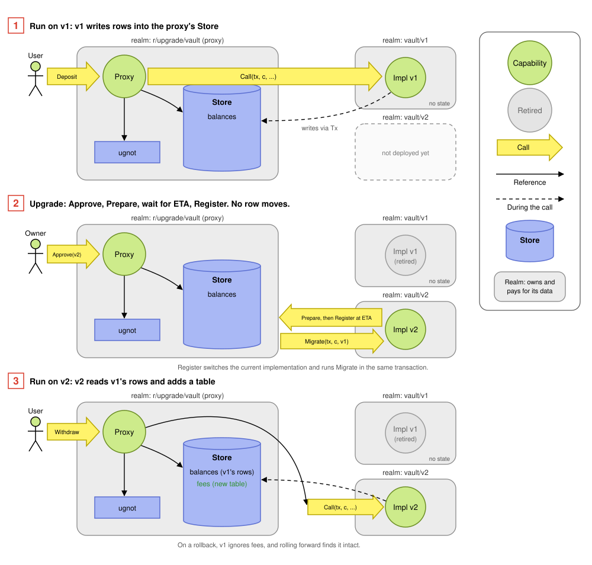
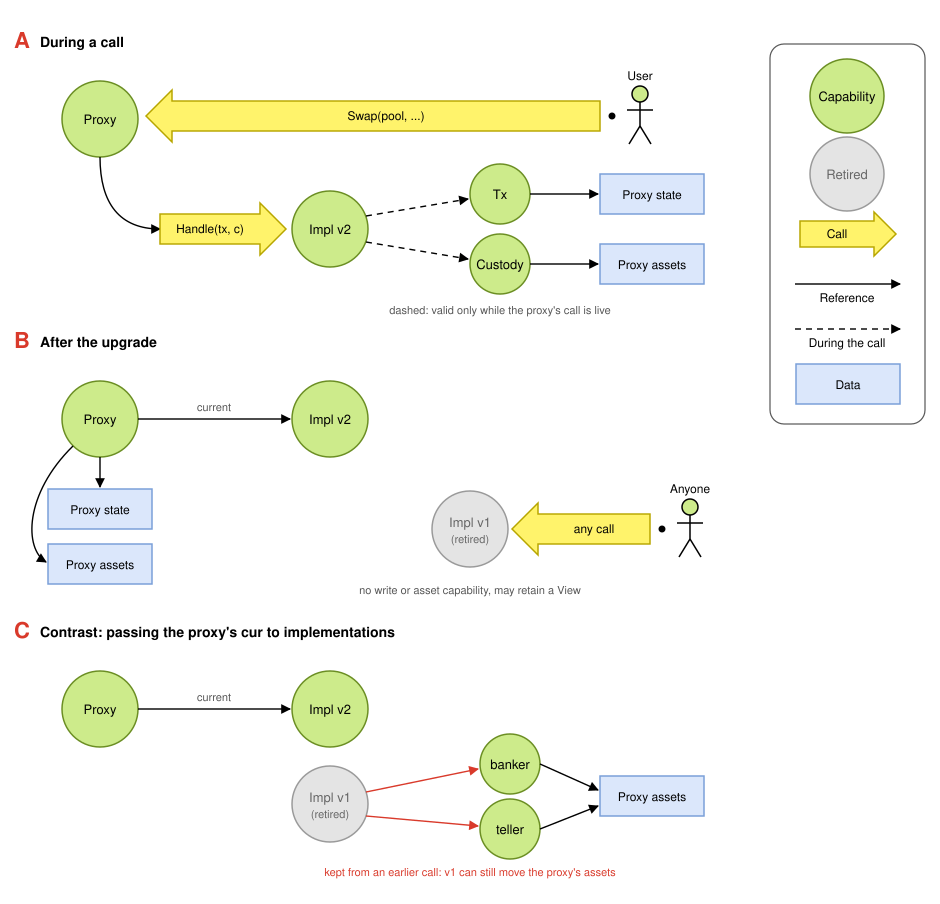

# gno-upgradable

An upgradable realm pattern for Gno. The proxy realm keeps the permanent
address, state, coins, and GRC20 tokens. An implementation realm supplies the
behavior and can be replaced after an on-chain delay.

The repository contains the reusable `gno.land/p/upgrade/v0` package and three
examples:

- `counter` is the smallest one: typed entry points only, with no method
  lists or string arguments, and a v2 that adds a Render and a migration.
- `vault` demonstrates string-dispatched calls, migrations, fees, and rollback.
- `amm` demonstrates typed entry points, token custody, callbacks, and
  reentrancy protection.

The examples exist to test the pattern. The AMM is not production-ready: its
liquidity and arithmetic rules are deliberately simplified.

## Quick start

The proxy realm holds an `upgrade.Proxy` and forwards its crossing functions
to it:

```go
// Package app is the proxy. Its address and API never change.
package app

import "gno.land/p/upgrade/v0"

const admin address = "g1..."

var proxy *upgrade.Proxy

type Implementation interface {
	upgrade.Dispatcher
	upgrade.Renderer
}

func init(cur realm) {
	proxy = upgrade.NewProxy(0, cur, admin, 17280) // delay in blocks
}

func Approve(cur realm, pkgPath string)          { proxy.Approve(0, cur, pkgPath) }
func Upgrade(cur realm, next Implementation)     { proxy.Upgrade(0, cur, next) }
func Call(cur realm, method, args string) string { return proxy.Call(0, cur, method, args) }
func Query(method, args string) string           { return proxy.Query(method, args) }
func Render(path string) string                  { return proxy.Render(path) }
```

Each implementation realm provides an implementation value and installs itself
with one parameterless crossing function:

```go
// Package app (v1) is an implementation. It holds no state of its own.
package app

import (
	"strconv"

	"gno.land/p/upgrade/v0"
	proxy "gno.land/r/you/app"
)

// Upgrade installs the first version at once. A later version calls it twice:
// once to start the delay, and again after it.
func Upgrade(cur realm) { proxy.Upgrade(cross(cur), Impl{}) }

type Impl struct{}

var _ proxy.Implementation = Impl{}

func (Impl) Methods() (calls, queries []upgrade.Method) {
	return []upgrade.Method{{Name: "Inc", Schema: "v1:void->void"}},
		[]upgrade.Method{{Name: "Get", Schema: "v1:address->int64"}}
}

func (Impl) Migrate(tx *upgrade.Tx, c *upgrade.Custody, from upgrade.ImplRef) {}

func (Impl) Call(tx *upgrade.Tx, c *upgrade.Custody, method, args string) string {
	key := tx.Caller().String()
	tx.Set("counts", key, tx.View().GetInt64("counts", key)+1)
	return ""
}

func (Impl) Query(v upgrade.View, method, args string) string {
	return strconv.FormatInt(v.GetInt64("counts", args), 10)
}

func (Impl) Render(v upgrade.View, path string) string { return "# App\n" }
```

`Migrate` receives an empty `ImplRef` on the first installation. On later
transitions, use `from.Path()` to select a predecessor realm or
`from.Is(path, value)` to distinguish values that realm has served.

The proxy refuses method names missing from `Methods`, so `Call` here
only sees `Inc`. See `src/r/upgrade/vault` for a complete example with coins,
admin methods, a migration and tests.

Before approval, `proxy.InspectImpl(next)` checks any `Impl` without changing
proxy state. Its `Candidate` result contains the declared call and query
methods plus any methods missing from the proxy's grow-only API. A typed-only
implementation has empty declared lists. Inspection cannot authenticate the
candidate's realm path or determine rollback status; `Upgrade` does that.

### String calls or typed entry points

`Impl` contains only the lifecycle shared by every implementation: `Migrate`. `Dispatcher` adds the optional string `Call`/`Query` interface,
and `Renderer` independently adds `Render`. A typed-only proxy can therefore
embed `Impl` without implementing unused string or rendering methods.

`Call` and `Query` deliberately give dispatchers a method name and one encoded
string. This is a design choice, not a MsgCall limit: MsgCall accepts multiple
primitive arguments. Each `Method` pairs the selector with an opaque schema ID.
The proxy compares both fields against a grow-only API, so changing an argument
or result encoding requires a new selector such as `WithdrawV2`. Prefer this
uniform envelope when it is sufficient.

Use `Invoke` and `Inspect` when an entry point needs typed arguments, a standard
token interface, or a callback. The proxy declares an interface that embeds the
needed upgrade capabilities, like the AMM's `Pool`, and asserts the
implementation to it. That interface is part of the proxy and cannot change,
so keep it to what must be typed. If it makes callbacks, guard every entry point
that can observe inconsistent application state or replace the implementation,
as the AMM does.

A typed proxy cannot gain entry points after it is deployed. A later version
can change behavior or add a `Render`, but a new function needs a new proxy. If
later versions may need new methods, forward `Call` and `Query` from the start.

The proxy names an implementation by the realm that installs it and the value
itself, compared with `==`. The chain authenticates the realm, and the value's
type decides the code that runs. Use a value type such as an empty struct: a
pointer compares by address, so a fresh pointer on each call never matches.
When `Upgrade` first checks a value, the proxy copies its method lists and saves
it. Calls route through that copy, and only the saved value can be installed. See [ADR 0002](docs/adr/0002-identify-implementations-by-value.md).

## Upgrade lifecycle

1. The proxy creates an empty `upgrade.Proxy` with an owner and delay.
2. After the first implementation realm is deployed, the owner approves its
   path and it calls `Upgrade` with its fixed implementation value. It is
   installed at once because there is no live code to protect yet.
3. The owner deploys and approves the next implementation realm.
4. The approved realm calls `Upgrade`. This checks the grow-only method API,
   saves the value, and starts the full delay only after the code exists
   on-chain.
5. At or after `ETA`, the same realm calls `Upgrade` again with the same value.
   The proxy installs the saved value and calls `Migrate` in the same
   transaction.



Application state in this pattern should live in the proxy realm, which owns it
and pays for its storage. The example implementation realms hold no application
state, but the package cannot prevent an implementation from using its own
realm globals. An upgrade does not move proxy data: it changes which code reads
and writes the proxy's `Store`, so v2 reads the rows v1 wrote and adds new tables
beside them.

The package authenticates the approved realm when it calls `Upgrade`, but it
cannot query whether an arbitrary package path is already deployed. The owner
must therefore treat “deploy, inspect, then approve” as an operational
invariant for the first implementation.

The owner may cancel a pending upgrade. `Freeze` permanently disables future
upgrades without disabling implementation-level admin methods. A rollback is
the same delayed lifecycle applied to an implementation value that the same
realm installed before. It skips the grow-only check, so methods added later
report as unavailable until a version that has them returns. Ownership transfer
completes only after the nominated address calls `AcceptOwnership` through the
proxy's corresponding forwarding function.

## Why object capabilities

A public realm cannot be deleted, so a replaced implementation stays callable
forever. The design question is therefore not only who may call the proxy, but
what an implementation can still do after it has been replaced.

In Gno, a live `cur` is authority, and some things built from it outlive the
call: a `RealmSend` banker, a GRC20 `RealmTeller` bound to the proxy's address,
and a pointer into the proxy's state. An implementation given the proxy's `cur`
or its raw tables could keep any of these and use them after an upgrade. An
allowlist of retired implementations would make revocation depend on keeping
that list correct.

The pattern instead hands authority to implementations as objects scoped to one
call:

- `Tx` and `Custody` hold the proxy's `cur` privately. Gno refuses to persist a
  realm value, so storing either handle aborts the transaction, and their
  methods reject use after the call. Revocation needs no bookkeeping: an
  implementation the proxy no longer calls retains no write or asset authority.
- `View` grants read access without write authority. It carries no realm value
  and may be retained after the call, so proxy state must not rely on being
  hidden from a retired implementation.
- Each handle grants only what it names. `Tx` writes the proxy's tables, and
  `Custody` moves assets without returning the banker or teller it builds.
- Handles cannot be forged. Opening one over the proxy requires the proxy's
  live `cur`, and a zero value declared elsewhere has no realm and refuses
  every call.



A shows the write and asset capabilities an implementation holds during a call.
B shows that a retired implementation retains none of those capabilities,
although it may retain a read-only `View`. C shows what it could keep if it were
given the proxy's `cur`.

This limits what a replaced implementation can do. It does not limit an
approved implementation while it runs, as the next section explains.

## Security model

As the previous section explains, the proxy owns all persistent write and asset
authority, and an implementation holds none of it between calls. A retained
`View` may still read proxy state. State values are restricted to plain types so
a pointer allocated by an implementation cannot remain writable after that
implementation is replaced.

An approved implementation is still fully trusted while it runs. It can change
state, move every asset held by the proxy, and spend GRC20 allowances granted to
the proxy. The delay gives users time to audit, revoke allowances, and exit; it
does not sandbox bad code.

The reverse limit also holds. An implementation can act outside the proxy only
through what the proxy hands it: `Tx`, `Custody`, and anything a typed proxy
builds itself, such as the AMM's `pay` callback. It cannot call another realm as
the proxy, so a version that needs a new kind of outward call, such as an oracle
or another protocol, needs a new proxy. Decide those calls before deploying.

In particular:

- Keep implementation values stateless value types, such as an empty struct.
  Store application state through `Tx` and hold assets through `Custody`.
- `Custody.ApproveForCall` clears each allowance before a successful call or
  migration returns. An on-chain cross-realm panic aborts the whole transaction;
  `revive` is enabled only in tests in the pinned Gno release. Persistent
  delegation needs a separate, explicitly tracked design.
- Export a parameterless `Upgrade` function that passes a fixed implementation
  value, so the value saved when the delay starts is the one installed.
- `Methods` checks selector, schema ID, and call/query placement. Review
  authorization and semantic compatibility separately; a schema ID is a
  commitment chosen by the implementation, not a generated ABI.
- Add tables when changing schemas. An in-place row-format change can make an
  old implementation unable to read state after rollback.
- A typed proxy that makes callbacks must lock every entry point that can read
  inconsistent state or replace the implementation. The AMM applies the same
  lock to `Swap`, reads, string calls, and `Upgrade`.
- Keep retired method names and return a clear panic. Only a rollback may
  temporarily leave a previously served method unavailable.

Every upgrade event includes the proxy realm in a `realm` attribute.
`UpgradePrepared` and `Upgraded` report whether the value is a rollback. Gno
has no reflection to name a value's type, so events name the realm path only.
`Render` prepends a banner for an approved upgrade, a pending upgrade or
rollback, or a freeze, which implementations cannot hide. An implementation that
is not a `Renderer` gets only the banner.
Production monitoring should consume the events rather than rely on users
opening the rendered page.

## Development

`mise.toml` pins the Gno release currently running on `gnoland-1`. Confirm the
live version from `https://rpc.gno.land/status` or the official mainnet upgrade
ledger before changing `GNO_REF`; keep `integration/go.mod` on the same tag.

```sh
mise run setup
mise run criteria
mise run integration-gnodev
```

`criteria` is the CI gate for machine-checkable criteria: lint, package tests,
filetests, and integration tests. Manual interface and portability review is
kept out of CI. Run `lint`, `test`, or `integration` individually for a targeted
check. `test` runs package tests and filetests. `integration` starts an in-memory
gno.land node and verifies signed upgrade transactions, state continuity, and
AMM callback reentrancy with the pinned mainnet release. CI additionally runs
`integration-gnodev`, which deploys v2 with `addpkg` against an isolated gnodev
chain and checks that state survives the upgrade.

Before deploying a proxy:

- choose an explicit admin user or governance realm and an escape delay;
- make every admin forwarder call the checks on `Proxy` rather than duplicating
  authorization in the realm;
- test first install, delayed upgrade, cancellation, ownership transfer,
  freeze, migration, rollback, unexpected coins, and retained-handle rejection;
- test callback and asset flows on a real node, not only with filetests; and
- audit the approved realm and the concrete implementation type it passes to
  `Upgrade`.
